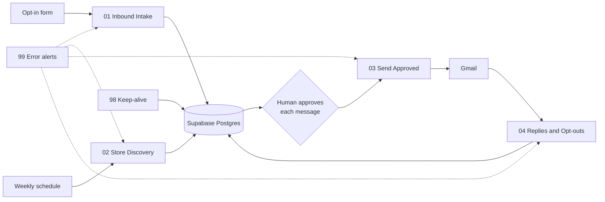
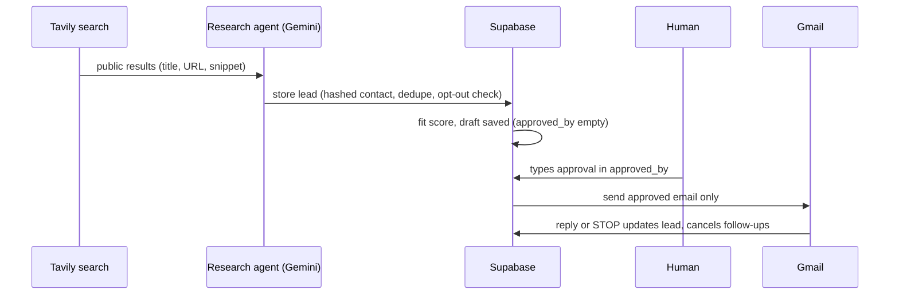

# lead-engine-n8n

**An AI-assisted lead engine built with n8n, Supabase and Gemini. It finds and scores prospects, drafts outreach, and sends nothing until a human approves it.**

> **Status: pilot, in progress.** Built in public during a 30-day LinkedIn challenge (25 Oct to 23 Nov 2026). Built and tested with test data. Not yet in use with real outreach.

   

## What it does

For a small sneaker and importation business, the engine:

1. **Captures** enquiries from an opt-in form and scores them 0 to 100 for intent.
2. **Finds** sneaker stores and resellers through public web search, researches each one with an AI agent, and scores how well it fits wholesale outreach.
3. **Drafts** a message for every good lead. A person reviews and approves each draft.
4. **Sends** approved emails, schedules follow-ups (day 1, 3, 7), and stops when someone replies or says STOP.
5. **Alerts** by email when anything fails.

## Architecture

The workflows never call each other. They communicate only through Supabase tables, so each can be built, tested and fail on its own.



How one outbound lead moves through the system:



More detail: [docs/architecture.md](docs/architecture.md).

## Workflows

| # | Workflow | What it does | Status | Video |
|---|----------|--------------|--------|-------|
| 01 | Inbound Intake | Form, normalise, hash, redact, save, Gemini score, alert on hot leads | Built, tested with 3 fake leads | [Watch](https://youtu.be/OCMGXGHKWM4) |
| 02 | Store Discovery | Weekly search, AI research agent, fit score, saves leads, drafts messages, emails a digest | Built, tested end to end | Coming soon |
| 03 | Send Approved | Sends only approved messages; schedules and drafts follow-ups | Built, tested with a test lead | Coming soon |
| 04 | Replies and Opt-outs | Polls Gmail, detects STOP, records opt-outs, cancels follow-ups | Built, tested | Coming soon |
| 98 | Keep-alive | Daily query so the free Supabase project does not pause | Built | n/a |
| 99 | Error alerts | Emails workflow name, failed node and error message | Built | n/a |
| 05 | Public form link (Cloudflare tunnel) | | Planned | n/a |
| 06 | Weekly report | | Planned | n/a |
| 07 | Evaluation (20 test enquiries, measured accuracy) | | Planned | n/a |

*All videos use test data only.*

## Safety by design

1. **Free tools only.**
2. **The AI never sends a message by itself.** A human approves each one, recorded in the `approved_by` column.
3. **Failures raise alerts.** An error workflow emails the owner.
4. **Personal data.** The inbound form message is redacted (emails and phone numbers replaced with labels) before AI scoring, and the separate name field is not sent. A name typed inside the message is not detected. Fit scoring for stores sends business type, city, region and a short reason written by the research agent. *Caveat:* the store finder sends public search results (title, URL, snippet) to Gemini, and a snippet can contain a shop's public phone number.
5. **Consent and opt-out.** The form has a required consent checkbox. Every message ends with "Reply STOP to opt out". A suppression table is checked before every send.

Contacts are stored with a SHA-256 hash (emails lowercased; store phone numbers converted to +234 format in workflow 02), so duplicates and opt-outs are matched on one consistent value. The hash is for matching, not anonymity: see Known limitations. See [docs/privacy-and-consent.md](docs/privacy-and-consent.md).

**Deliberate boundaries:** WhatsApp messages are drafts only, sent by hand through a `wa.me` link. Instagram, Facebook and Google Maps are not scraped. Only public search results and public business sites are used.

## Tech stack

| Part | Choice | Why |
|------|--------|-----|
| Orchestration | n8n 2.41.4, self-hosted | Visual, testable, free |
| Database | Supabase (free Postgres) via Session pooler | Shared hub between workflows |
| AI | Gemini (Google AI Studio free tier) | Scoring and research agent |
| Search | Tavily free API | Public web search |
| Email | Gmail OAuth | Alerts, approved sends, reply detection |

## Quick start

1. Create a free Supabase project and run the schema in `sql/`.
2. In n8n, create credentials: Postgres (Session pooler, port 5432), Gemini, Tavily (Header Auth), Gmail OAuth. See `.env.example` for what each needs.
3. Import the JSON files from `workflows/` and re-select credentials on each node.
4. Insert one `businesses_config` row using placeholder values.
5. Set **Error Workflow** to 99 in workflows 01 to 04, then publish 99.
6. Test with fake leads. Publish a workflow before using its Production URL.

## Results so far (test and pilot data)

| Measure (store discovery, 15 results) | Before tuning | After tuning |
|---|---|---|
| Gemini calls | 150 | 22 to 30 |
| Page fetches | 48 | 9 |
| Run time | hung 15+ minutes | about 7 minutes |

Tuning: max iterations 3, page-tool timeout, retry limits, a known-sites filter, one page visit per lead. No precision or accuracy figures exist yet. That is what workflow 07 is for.

## Known limitations

- n8n runs on a laptop at `localhost:5678`, so it works only while the laptop and n8n are on. Forms are not reachable from the internet without a tunnel (workflow 05).
- Free-tier limits: Gemini about 15 requests per minute per model plus a daily cap, with occasional 503 overloads. Tavily about 1,000 credits a month.
- Free Supabase projects pause after about a week of inactivity (workflow 98 mitigates this).
- A Google Cloud app in Testing mode makes the Gmail token expire after 7 days.
- Contact hashes are plain SHA-256. Phone numbers have a small search space, so a hash can be reversed by brute force. A keyed hash (HMAC with a secret) would fix this and is on the roadmap.
- STOP replies are matched to a lead by the sender's email address. A STOP sent from a different address than the one the message went to is not recorded.
- The research agent reads untrusted web text (search snippets and one page). Its output is checked against a schema, and nothing is sent without human approval, but a page could still try to steer the model.
- Redaction is rule-based (regular expressions for emails and phone numbers). It does not detect names or addresses typed into a message.
- Most stores found have a phone number and no email, so most drafts are WhatsApp drafts sent manually.

## Roadmap

- [ ] 05 Public form link through a Cloudflare tunnel
- [ ] 06 Weekly report
- [ ] 07 Evaluation workflow with a measured accuracy number
- [ ] Switch contact hashing to a keyed hash (HMAC) across workflows 01, 02 and 04
- [ ] Add name redaction to the inbound form step
- [ ] One merged demo canvas with sticky-note sections

## Repository layout

```
lead-engine-n8n/
  README.md
  SECURITY.md
  .env.example
  workflows/   n8n JSON exports (01, 02, 03, 04, 98, 99)
  sql/         schema and placeholder seed
  docs/        architecture, privacy and consent, design decisions, lessons learned, screenshots
```

## Documentation

- [Architecture](docs/architecture.md)
- [Design decisions](docs/design-decisions.md)
- [Privacy and consent](docs/privacy-and-consent.md)
- [Lessons learned](docs/lessons-learned.md)

## About

Built by Jude, an Electrical and Electronics Engineering graduate learning n8n and AI automation. Connect on [LinkedIn](https://www.linkedin.com/in/jude-ughakpoteni-337393413).
